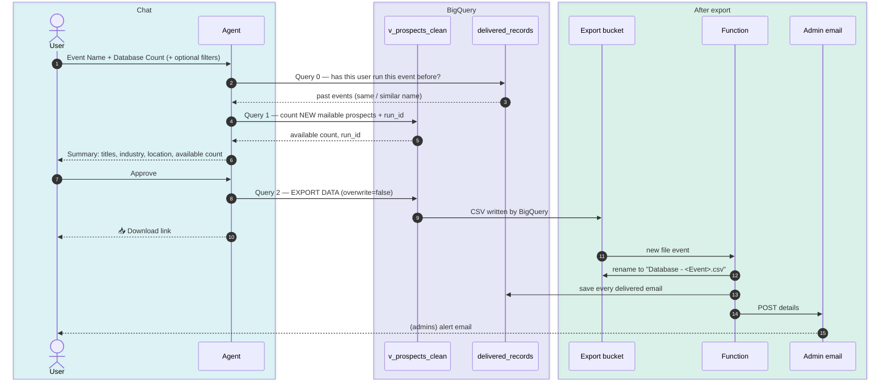
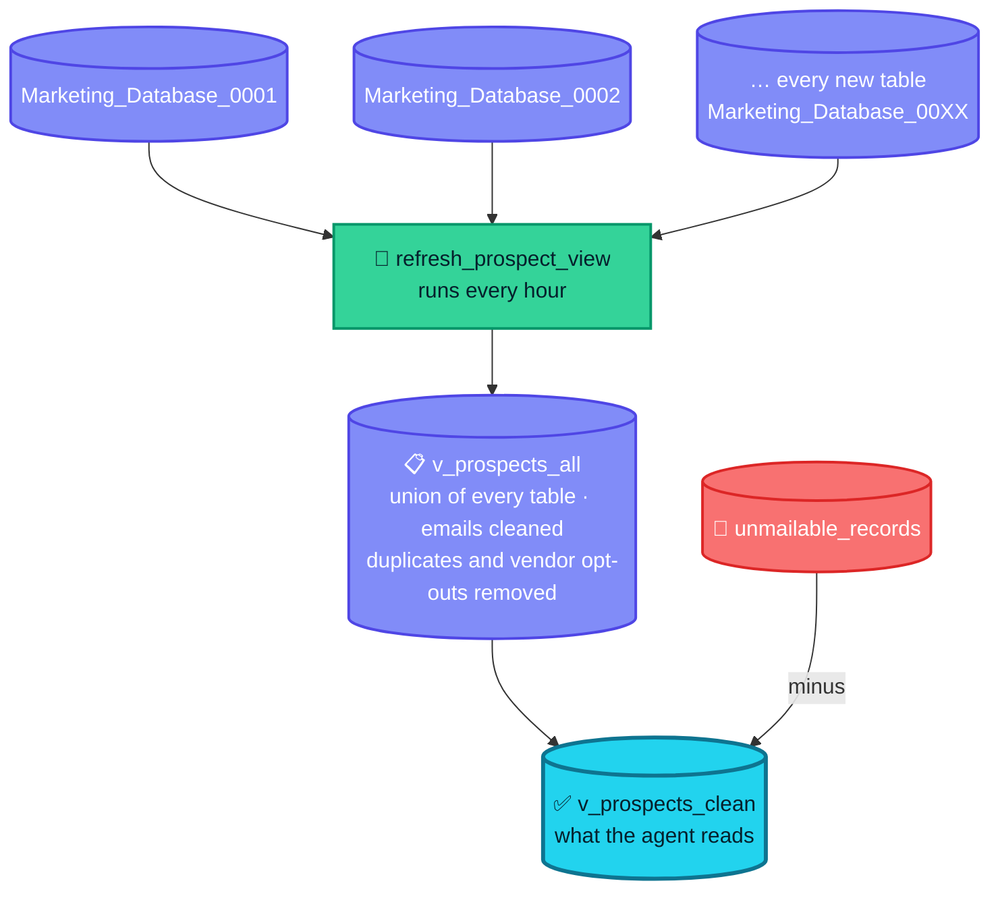
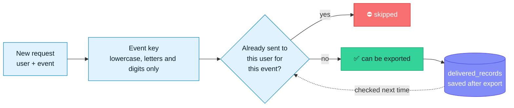
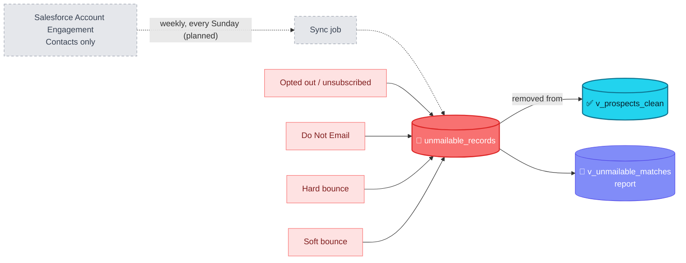
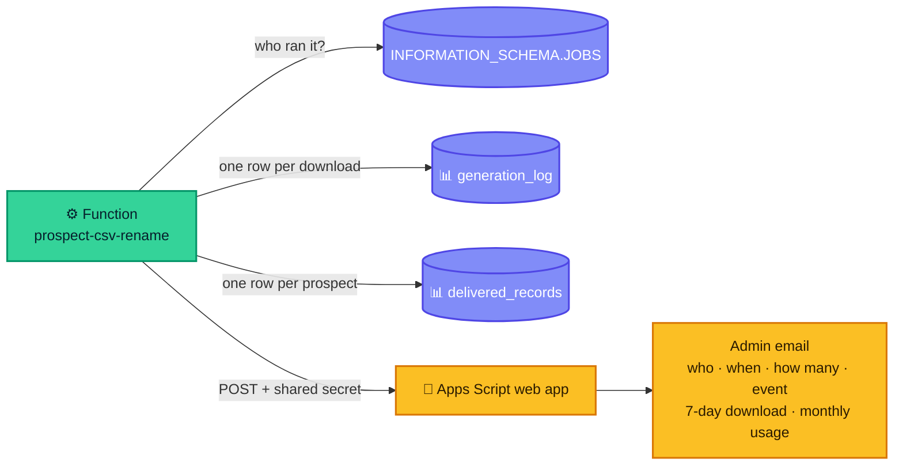
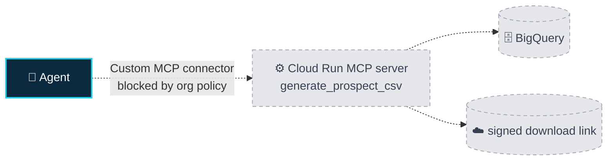

# 🏗️ Marketing DataLake Agent — Architecture

How a chat message becomes a clean, event-ready prospect CSV, and how every download is checked, logged and reported.

**Colour key used in every diagram:** 🩵 people and the agent · 🟪 BigQuery · 🟦 Cloud Storage · 🟩 Cloud Run function · 🟨 email · 🟥 blocked / unmailable · ⬜ planned

---

## 1. The big picture

```mermaid
flowchart LR
  U(["👤 Marketing user"]) -->|"event name + count"| A["🤖 Marketing DataLake Agent<br/>Gemini Enterprise"]
  A -->|"count, then export"| BQ[("🗄️ BigQuery data lake<br/>all vendor tables")]
  BQ -->|"EXPORT DATA"| GCS[("☁️ Cloud Storage<br/>export bucket")]
  A -->|"📥 download link"| U
  GCS -->|"new file"| F["⚙️ Cloud Run function"]
  F -->|"logs"| LOG[("📊 Log tables")]
  F -->|"alert"| M["📧 Apps Script email"]
  M --> AD(["👥 Admins"])
  UM[("🚫 Unmailable records")] -->|"always excluded"| BQ
  SF["Salesforce<br/>(weekly sync, planned)"] -.-> UM

  classDef person fill:#22d3ee,stroke:#0e7490,color:#06202c,stroke-width:2px
  classDef agent fill:#0b2a3f,stroke:#22d3ee,color:#ffffff,stroke-width:3px
  classDef bq fill:#818cf8,stroke:#4f46e5,color:#ffffff,stroke-width:2px
  classDef gcs fill:#38bdf8,stroke:#0284c7,color:#06202c,stroke-width:2px
  classDef fn fill:#34d399,stroke:#059669,color:#06202c,stroke-width:2px
  classDef mail fill:#fbbf24,stroke:#d97706,color:#2a1a00,stroke-width:2px
  classDef block fill:#f87171,stroke:#dc2626,color:#ffffff,stroke-width:2px
  classDef planned fill:#e5e7eb,stroke:#9ca3af,color:#374151,stroke-dasharray:5 4
  class U,AD person
  class A agent
  class BQ,LOG bq
  class GCS gcs
  class F fn
  class M mail
  class UM block
  class SF planned
```

| Part | What it does | Where |
|---|---|---|
| 🤖 **Agent** | Collects the request, adds ~20 job titles, counts new prospects, waits for **Approve**, runs the export | Gemini Enterprise (instructions in `agent/`) |
| 🗄️ **Data lake** | Every vendor table in one cleaned view; unmailable contacts removed | BigQuery (`bigquery/setup_auto_view.sh`) |
| ☁️ **Export bucket** | Holds each CSV for 7 days | Cloud Storage |
| ⚙️ **Function** | Names the file, records who got which prospect, writes the log, triggers the email | Cloud Run (`csv-helper/`) |
| 📧 **Email** | Sends the admin alert with monthly usage | Apps Script (`apps-script/Code.gs`) |

---

## 2. One request, step by step

**Why this design:** Gemini Enterprise tools can't pass data to each other, so the agent never handles the rows itself. BigQuery writes the CSV straight to Cloud Storage with `EXPORT DATA`, and the user gets a direct link.

---

## 3. The data lake

- **Grows by itself:** upload a table named `Marketing_Database_00XX` with the same column names (all `STRING`) and it's included within an hour.
- **Why a union and not a wildcard:** `EXPORT DATA` can't read wildcard tables, so the hourly procedure rebuilds the view as a `UNION ALL` of named tables.
- **Columns (11):** Company Name · Website · First Name · Last Name · Job Title · Email ID · Industry · Prospect LinkedIn · City · State · Country.

---

## 4. No repeats

- Same user + same event → never the same prospect twice.
- A different event, or a different user, can get the same prospect.
- "Cloud Summit – Texas" and "cloud summit texas" are the **same** event (only capitals, spaces and symbols differ). A close but different name makes the agent ask *"Is this the same event?"*
- Each export has a unique ID (`YYYYMMDDHHMMSS_xxxxxx`) and is written with `overwrite=false`, so files are never replaced.

---

## 5. Unmailable block

Unmailable contacts are blocked for **every user and every event**, permanently. Today the list holds vendor-flagged opt-outs; the weekly Salesforce sync is the next step (see the open issues).

---

## 6. Logs and admin alerts

- **Tamper-proof identity:** the user comes from BigQuery itself (`SESSION_USER()` and the job history), not from what the AI says.
- **Heavy use flag:** the email highlights users above 10,000 records in a month.

---

## 7. Access and security

| Who | Needs |
|---|---|
| 👤 Regular user | Gemini Enterprise user role + licence · BigQuery Job User + Data Viewer · create/read on the export bucket only |
| 👥 Admin | The above, plus access to the log tables |
| ⚙️ Function | Its own service account: write to logs, read jobs, rename files |

- The repository is public and holds **no** real project IDs, emails, URLs, keys or secrets — only placeholders such as `your-gcp-project-id` and `admin-one@example.com`.
- The Apps Script URL and shared secret live only in a git-ignored `env.yaml` used at deploy time.
- Every push and pull request runs a secrets check (`scripts/check-secrets.sh`).
- Exported files delete themselves after 7 days.

---

## 8. Optional MCP server (not in use)

Built and tested (500 of 500 records), but the organisation policy blocks Custom MCP connectors in Gemini Enterprise. The live design uses `EXPORT DATA` instead. Kept in `mcp-server-optional/` in case the policy changes.

---

## 9. Known limits

- Up to **5,000** records per request.
- The delivery log is written about a minute after each export; re-running the same event inside that minute can repeat prospects.
- **Approve** is typed in the chat (Gemini Enterprise agents can't show custom buttons).
- The Salesforce sync is planned, not yet built.
