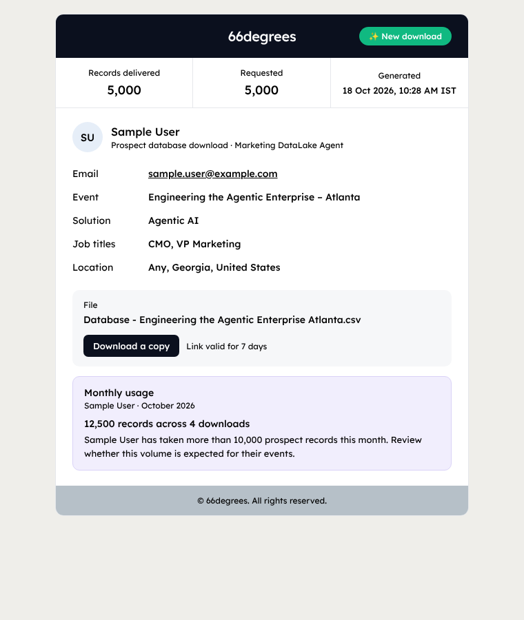
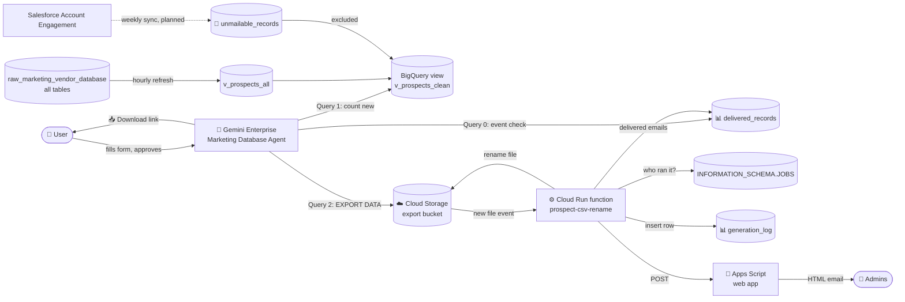

<div align="center">

# 🎯 Marketing Database Agent

### From a chat message to a clean, event-ready prospect list in seconds.

A **Gemini Enterprise** agent that searches a **BigQuery** marketing database, suggests related
job titles, shows how many **new** prospects are available, and after the user approves, builds a
downloadable prospect CSV — never repeating a prospect for the same user and event, and never
including unmailable contacts. Admins get a full audit trail of every download.

<br>


**[Examples](examples/EXAMPLES.md)** · **[Rules](#rules)** · **[Configuration](#configuration)** · **[Setup](#setup)** · **[Troubleshooting](docs/TROUBLESHOOTING.md)**

</div>

---

## ✨ Highlights

| | |
|---|---|
| 💬 **Chat-first** | Users fill a short form in Gemini Enterprise. Only **Event Name** and **Database Count** are required. |
| 🧠 **Smart titles** | The agent adds ~20 related senior job titles from the Event, Solution and Industry. The user's own titles always come first. |
| 📊 **Approve before export** | A summary shows the titles and how many **new** prospects are available. Nothing is exported until the user replies **Approve**. |
| 🔁 **No repeats** | The same user never gets the same prospect twice for the same event. A different event or user can. |
| 🚫 **Unmailable block** | Opted-out, do-not-email and bounced contacts (from Salesforce) never appear in any CSV. |
| 🏭 **Industry first** | Matching-industry companies are picked first and listed at the top. Industry never removes anyone. |
| 📥 **One-click CSV** | A direct download link, saved as `Database - <Event Name>.csv`. No rows clutter the chat. |
| ♾️ **Grows automatically** | Every table uploaded to the source dataset is included within an hour. No code changes. |
| 🔔 **Admin alerts** | Every download emails the admins: who, when, how many, for which event. |
| 📊 **Permanent audit log** | One row per download plus one row per delivered prospect in BigQuery. |
| 🔒 **Tamper-proof identity** | The user's identity comes from BigQuery itself (`SESSION_USER()` and job history), not from the AI. |

---

## 💬 How users use it

```text
Event Name:      Cloud Modernization Roundtable — Chicago   (required)
Database Count:  300                                       (required, max 5,000)
Solution:        Cloud
Industry:        Financial Services
Job Title(s):    CIO, VP of IT
City:            Chicago
State:           Illinois
Country:         United States
```

The agent replies with a summary:

```text
Cloud Modernization Roundtable — Chicago
Your titles: CIO, VP of IT
Titles I added: CTO, CDO, Chief Digital Officer, VP of Cloud, VP of Infrastructure, Head of Cloud, Director of Cloud, … (~20)
Industry: Financial Services, prioritised
Location: Chicago, Illinois, United States
✅ 1642 new prospects available (148 from your titles)
Reply Approve to export 300, or tell me which titles to add or remove.
```

After **Approve**:

```text
✅ Prospect database ready — Cloud Modernization Roundtable — Chicago
Records: 300 of 300 requested
📥 Download CSV
✅ All set! Your prospect database is ready. Download your CSV and start prospecting!
```

**CSV columns (11):** Company Name · Website · First Name · Last Name · Job Title · Email ID ·
Industry · Prospect LinkedIn · City · State · Country

> 📚 More scenarios (repeat runs, shortfalls, similar event names, title matching, SQL, log queries) in
> **[examples/EXAMPLES.md](examples/EXAMPLES.md)**.

---

<a id="rules"></a>

## 📏 Rules

| # | Rule |
|---|---|
| 1 | **Event names:** same event if only capitals, dashes, spaces or symbols differ. Different words = different event. If a name is close but not exact, the agent asks *"Is this the same event?"* |
| 2 | **No repeats:** the same user never gets the same prospect twice for the same event. A different event or a different user can get the same prospect. |
| 3 | **Unmailable:** always blocked, for every user and every event. |
| 4 | **Available count:** only new, mailable prospects are counted. If there are not enough, the user can approve what's available, add more titles, or edit titles. |
| 5 | **Titles:** ~20 added senior titles (min 15, max 25); user titles always first; user can add or remove titles before approving. |
| 6 | **Industry:** optional; puts matching companies first; never removes anyone. |
| 7 | **Required fields:** only Event Name and Database Count. Everything else is optional. |
| 8 | **Limit:** 5,000 records per request. |

---

## 🔔 What admins get

<table>
<tr>
<td width="55%" valign="top">

**📧 An instant email** to the admins
- user name and email, timestamp
- records delivered vs requested
- event, solution, industry, job titles, location
- a 7-day **Download a copy** button
- the user's **monthly usage** (flags heavy use above 10,000 records)

**🗄️ Permanent logs** in BigQuery
- `prospect_agent_logs.generation_log` — one row per download
- `prospect_agent_logs.delivered_records` — one row per delivered prospect

</td>
<td width="45%" valign="top">



</td>
</tr>
</table>

---

## 🏗️ Architecture



<details>
<summary><b>Step by step</b></summary>

1. **Agent** collects the details (only Event Name and Database Count are required).
2. **Query 0** checks the user's previous events in `delivered_records` (same event? similar name?).
3. The agent builds the user's titles, ~20 added titles and backup titles, then runs
   **Query 1**, which counts new prospects (excluding anyone this user already received for this event).
4. The agent shows a **summary**. The user replies **Approve** (or adds/removes titles).
5. **Query 2** (`EXPORT DATA`) writes the CSV straight into Cloud Storage. The file ID is
   `YYYYMMDDHHMMSS_xxxxxx` from Query 1 and files are never overwritten.
6. **The views:** `v_prospects_all` unions every source table, cleans emails, removes duplicates and
   vendor opt-outs, and fills City/State/Country from fallback columns. A stored procedure rebuilds it
   **every hour**. `v_prospects_clean` = `v_prospects_all` minus `unmailable_records`.
7. **The Cloud Run function** fires when the file lands:
   - sets the download name → `Database - <Event Name>.csv`
   - finds the export job in `INFORMATION_SCHEMA.JOBS` (real user and time)
   - saves every delivered email to `delivered_records`
   - counts the actual rows and writes a row to `generation_log`
   - calls the **Apps Script** web app, which sends the HTML email
8. Exported files **auto-delete after 7 days**.

</details>

---

## 📁 Repository structure

```text
marketing-database-agent/
├── 🤖 agent/
│   ├── agent_instructions.md      # paste into the agent's Instructions
│   └── starter_prompt.txt         # the agent's Personalisation / starter form
├── 🗄️ bigquery/
│   └── setup_auto_view.sh         # views over ALL tables + unmailable block + hourly refresh
├── ⚙️ csv-helper/                  # Cloud Run function: rename + delivery log + generation log + email
│   ├── index.js
│   ├── package.json
│   ├── deploy_logging.sh
│   └── test_logging.sh
├── 📧 apps-script/
│   └── Code.gs                    # HTML admin email sender (web app)
├── 📚 examples/
│   ├── EXAMPLES.md                # worked examples
│   └── sample_output.csv          # fictional sample output
├── 📄 docs/
│   ├── admin-email-preview.png
│   └── TROUBLESHOOTING.md
└── 🧪 mcp-server-optional/         # built, but blocked by org policy (not in use)
```

---

<a id="configuration"></a>

## ⚙️ Configuration

> 🔐 **This repository is public.** It contains **no** real project IDs, emails, URLs, API keys or secrets.
> Never commit `env.yaml`, the Apps Script URL, the mail secret or Salesforce credentials.

Replace these placeholders before deploying:

| Placeholder | Replace with | Used in |
|---|---|---|
| `your-gcp-project-id` | Your Google Cloud project ID | all scripts, agent instructions |
| `YOUR_PROJECT_NUMBER` | `gcloud projects describe <id> --format="value(projectNumber)"` | `bigquery/`, `csv-helper/`, `mcp-server-optional/` |
| `admin-one@example.com`, `admin-two@example.com` | Admin emails that receive alerts | `csv-helper/`, `apps-script/Code.gs` |
| `PASTE_YOUR_SECRET_HERE` | `openssl rand -hex 16` | `apps-script/Code.gs` |

<details>
<summary><b>One-command replace</b></summary>

```bash
grep -rlI --exclude-dir=.git -e your-gcp-project-id -e YOUR_PROJECT_NUMBER \
  -e admin-one@example.com -e admin-two@example.com . | xargs sed -i \
  -e 's/your-gcp-project-id/<PROJECT_ID>/g' \
  -e 's/YOUR_PROJECT_NUMBER/<PROJECT_NUMBER>/g' \
  -e 's/admin-one@example.com/<ADMIN_EMAIL_1>/g' \
  -e 's/admin-two@example.com/<ADMIN_EMAIL_2>/g'
```

</details>

The **Apps Script URL** and the **secret** are passed to `deploy_logging.sh` at deploy time and
saved only in a local, git-ignored `env.yaml`. They are never committed.

Function environment variables: `PROJECT_ID`, `BQ_LOCATION`, `LOG_TABLE`, `DELIVERED_TABLE`
(defaults to `<project>.prospect_agent_logs.delivered_records`), `ADMIN_EMAILS`,
`MAIL_WEBHOOK_URL`, `MAIL_SECRET`.

---

<a id="setup"></a>

## 🚀 Setup from scratch

All commands run in **Cloud Shell**.

**1️⃣ Views, unmailable block and hourly refresh**
```bash
cd bigquery && bash setup_auto_view.sh
```

**2️⃣ Export bucket** (skip if it already exists)
```bash
P=your-gcp-project-id; SA=YOUR_PROJECT_NUMBER-compute@developer.gserviceaccount.com
gcloud storage buckets create gs://$P-prospect-exports --location=us-central1 --uniform-bucket-level-access --public-access-prevention
gcloud storage buckets add-iam-policy-binding gs://$P-prospect-exports --member="serviceAccount:$SA" --role="roles/storage.objectAdmin"
gcloud iam service-accounts add-iam-policy-binding $SA --member="serviceAccount:$SA" --role="roles/iam.serviceAccountTokenCreator"
```
Add a 7-day delete lifecycle rule (see `mcp-server-optional/deploy.sh`). On a brand-new project, also
grant `roles/pubsub.publisher` to the Cloud Storage service agent and `roles/eventarc.eventReceiver`
to the runtime service account.

**3️⃣ Email sender** in [script.google.com](https://script.google.com)
- new project → paste `apps-script/Code.gs` → set `SHARED_SECRET`
- run `sendTestEmail` once (authorise)
- **Deploy → New deployment → Web app** · Execute as: *Me* · Access: *Anyone* → copy the URL

**4️⃣ Rename + logs + email function**
```bash
cd csv-helper
bash deploy_logging.sh "<APPS_SCRIPT_WEB_APP_URL>" "<SECRET>"
bash test_logging.sh        # exports 25 rows, shows the log rows, sends a test email
```
To update only the code later (keeps all existing settings):
```bash
gcloud functions deploy prospect-csv-rename --gen2 --region=us-central1 --runtime=nodejs22 --source=. --entry-point=setDownloadName
```

**5️⃣ The agent** (Gemini Enterprise)
- Model → Gemini 4 Argon
- Instructions → paste `agent/agent_instructions.md`
- Personalisation / starter prompt → paste `agent/starter_prompt.txt`
- Keep the **BigQuery** connector attached

**6️⃣ User access** (each regular user)
- Gemini Enterprise: `roles/discoveryengine.user` + a Gemini Enterprise license in the app's location
- BigQuery: `roles/bigquery.jobUser` + `roles/bigquery.dataViewer`
- Export bucket only: `roles/storage.objectCreator` + `roles/storage.objectViewer`

---

## ➕ Adding a new marketing database

1. BigQuery → `raw_marketing_vendor_database` → **Create table** → upload the CSV.
2. Name it `Marketing_Database_00XX` (next number). Use the **same column names** as existing tables.
3. Set every column to **STRING** (don't use schema auto-detect).
4. Done — included within an hour, or immediately with:
   ```sql
   CALL `your-gcp-project-id.raw_marketing_vendor_database.refresh_prospect_view`();
   ```

---

## 📊 Admin queries

<details open>
<summary><b>Who took how much this month</b></summary>

```sql
SELECT user_email, COUNT(*) AS downloads, SUM(delivered_count) AS records
FROM `your-gcp-project-id.prospect_agent_logs.generation_log`
WHERE DATE(generated_at, 'Asia/Kolkata') >= DATE_TRUNC(CURRENT_DATE('Asia/Kolkata'), MONTH)
GROUP BY user_email
ORDER BY records DESC;
```
</details>

<details>
<summary><b>Latest 20 generations</b></summary>

```sql
SELECT FORMAT_TIMESTAMP('%d %b %Y %I:%M %p', generated_at, 'Asia/Kolkata') AS time_ist,
       user_email, event_name, solution, requested_count, delivered_count
FROM `your-gcp-project-id.prospect_agent_logs.generation_log`
ORDER BY generated_at DESC
LIMIT 20;
```
</details>

<details>
<summary><b>Is the unmailable filter active? (should be true)</b></summary>

```sql
SELECT CONTAINS_SUBSTR(view_definition, 'unmailable_records') AS block_is_active
FROM `your-gcp-project-id.raw_marketing_vendor_database.INFORMATION_SCHEMA.VIEWS`
WHERE table_name = 'v_prospects_clean';
```
</details>

<details>
<summary><b>Check for repeats (should return no rows)</b></summary>

```sql
SELECT user_email, event_key, email, COUNT(DISTINCT gcs_uri) AS times
FROM `your-gcp-project-id.prospect_agent_logs.delivered_records`
GROUP BY user_email, event_key, email
HAVING COUNT(DISTINCT gcs_uri) > 1;
```
</details>

<details>
<summary><b>Rebuild the view right now (after uploading a new table)</b></summary>

```sql
CALL `your-gcp-project-id.raw_marketing_vendor_database.refresh_prospect_view`();
```
</details>

More in **[examples/EXAMPLES.md](examples/EXAMPLES.md#10-the-log-tables)**.

---

## 🧱 Google Cloud resources

| Resource | Name |
|---|---|
| 🗄️ Source dataset | `raw_marketing_vendor_database` (all current and future tables) |
| 🧹 Agent view | `raw_marketing_vendor_database.v_prospects_clean` (all prospects minus unmailable) |
| 📋 Full prospect view | `Unmailable_Records.v_prospects_all` (rebuilt hourly) |
| 🚫 Block list | `Unmailable_Records.unmailable_records` |
| 🔎 Blocked report | `Unmailable_Records.v_unmailable_matches` |
| 🔁 Refresh | procedure `raw_marketing_vendor_database.refresh_prospect_view` + scheduled query "Refresh prospect view" (hourly) |
| ☁️ Export bucket | `<project>-prospect-exports` (7-day auto-delete) |
| 📊 Log tables | `prospect_agent_logs.generation_log`, `prospect_agent_logs.delivered_records` |
| ⚙️ Cloud Run function | `prospect-csv-rename` (us-central1, bucket trigger) |
| 📧 Apps Script | "Prospect Database Admin Emails" (web app) |

---

## ⚠️ Known limits

- Maximum **5,000** records per request.
- Users need BigQuery access (Job User + Data Viewer) and read/create access to the export bucket,
  because the BigQuery connector runs queries as the user.
- The unmailable block list is filled by a **weekly Salesforce sync (planned, not yet built)**.
  Until it runs, only vendor-flagged opt-outs are excluded.
- The delivery log is written about a minute after each export. Re-running the same event within
  that minute can repeat prospects.
- **Approve** is typed in the chat. Gemini Enterprise agents can't show custom buttons.
- The model occasionally writes a short status line before the summary (cosmetic).
- Gmail can't load the Lexend web font, so the email falls back to Gmail's default font.
- Custom MCP connectors are blocked by the org policy, see [`mcp-server-optional/`](mcp-server-optional/README.md).

Hit a problem? See **[docs/TROUBLESHOOTING.md](docs/TROUBLESHOOTING.md)**.

---

<div align="center">

Built by **Deepanjan Dasgupta** & **Neelkant Ekbote**

</div>
