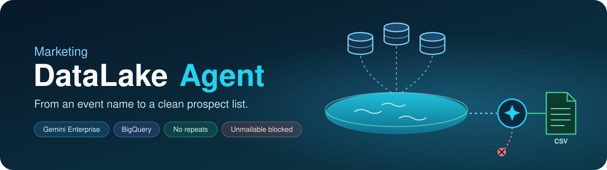
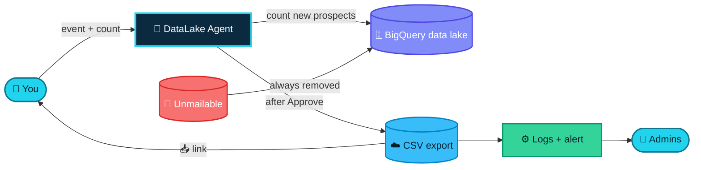

<div align="center">



<br><br>

[](https://github.com/nexoradev-stack/Marketing-DataLake-Agent/actions/workflows/node.js.yml)


[💬 How it works](#-how-users-use-it) · [📏 Rules](#-rules) · [🏗️ Architecture](ARCHITECTURE.md) · [🚀 Setup](#-setup-from-scratch) · [📚 Examples](examples/EXAMPLES.md) · [🛠️ Troubleshooting](docs/TROUBLESHOOTING.md) · [🙌 Credits](#-credits)

</div>

---

## ✨ What it does

A **Gemini Enterprise** agent for the marketing team. Type an event name and how many prospects you need. The agent searches one **BigQuery data lake** built from every vendor database, suggests the right job titles, shows how many **new** prospects are available, and, after you approve, hands you a ready-to-use CSV.

It never repeats a prospect for the same user and event, never includes unmailable contacts, and tells the admins about every download.

| | |
|---|---|
| 💬 **Chat-first** | Only **Event Name** and **Database Count** are required. Everything else is optional. |
| 🧠 **Smart titles** | Adds ~20 related senior job titles from the Event, Solution and Industry. Your own titles always come first. |
| ✅ **Approve before export** | A summary shows the titles and how many **new** prospects are available. Nothing is exported until you reply **Approve**. |
| 🔁 **No repeats** | The same user never gets the same prospect twice for the same event. |
| 🚫 **Unmailable block** | Opted-out, do-not-email and bounced contacts never appear in any CSV. |
| 🏭 **Industry first** | Matching-industry companies go to the top. Industry never removes anyone. |
| 📥 **One-click CSV** | A direct download link, saved as `Database - <Event Name>.csv`. |
| ♾️ **Grows by itself** | Every new vendor table is included within an hour. No code changes. |
| 🔔 **Admin alerts** | Every download emails the admins: who, when, how many, which event, monthly usage. |
| 🔒 **Tamper-proof logs** | Identity comes from BigQuery itself, not from the AI. One log row per download and per prospect. |

---

## 🧭 How it works



Every part, with a diagram each (data lake, no-repeat logic, unmailable block, logs, access), is in **[🏗️ ARCHITECTURE.md](ARCHITECTURE.md)**.

---

## 💬 How users use it

```text
Event Name:      Cloud Modernization Roundtable — Chicago   (required)
Database Count:  300                                       (required, max 5,000)
Solution:        Cloud
Industry:        Financial Services
Job Title(s):    CIO, VP of IT
City:            Chicago
State:           Illinois
Country:         United States
```

The agent replies with a summary:

```text
Cloud Modernization Roundtable — Chicago
Your titles: CIO, VP of IT
Titles I added: CTO, CDO, Chief Digital Officer, VP of Cloud, VP of Infrastructure, Head of Cloud, … (~20)
Industry: Financial Services, prioritised
Location: Chicago, Illinois, United States
✅ 1642 new prospects available (148 from your titles)
Reply Approve to export 300, or tell me which titles to add or remove.
```

After **Approve**:

```text
✅ Prospect database ready — Cloud Modernization Roundtable — Chicago
Records: 300 of 300 requested
📥 Download CSV
```

**CSV columns (11):** Company Name · Website · First Name · Last Name · Job Title · Email ID · Industry · Prospect LinkedIn · City · State · Country

> 📚 More scenarios (repeat runs, shortfalls, similar event names, title matching, SQL, log queries) in **[examples/EXAMPLES.md](examples/EXAMPLES.md)**.

---

## 📏 Rules

| # | Rule |
|---|---|
| 1️⃣ | **Event names:** same event if only capitals, dashes, spaces or symbols differ. Different words = different event. A close name makes the agent ask *"Is this the same event?"* |
| 2️⃣ | **No repeats:** the same user never gets the same prospect twice for the same event. A different event or user can. |
| 3️⃣ | **Unmailable:** always blocked, for every user and every event. |
| 4️⃣ | **Available count:** only new, mailable prospects are counted. If there aren't enough, approve what's available, add titles, or edit titles. |
| 5️⃣ | **Titles:** ~20 added senior titles (min 15, max 25); your titles always first; add or remove before approving. |
| 6️⃣ | **Industry:** optional; puts matching companies first; never removes anyone. |
| 7️⃣ | **Required fields:** only Event Name and Database Count. |
| 8️⃣ | **Limit:** 5,000 records per request. |

---

## 🔔 What admins get

<table>
<tr>
<td width="55%" valign="top">

**📧 An instant email**
- user name and email, timestamp
- records delivered vs requested
- event, solution, industry, job titles, location
- a 7-day **Download a copy** button
- the user's **monthly usage** (flags use above 10,000 records)

**🗄️ Permanent logs** in BigQuery
- `prospect_agent_logs.generation_log`: one row per download
- `prospect_agent_logs.delivered_records`: one row per delivered prospect

</td>
<td width="45%" valign="top">


</td>
</tr>
</table>

---

## 📁 Repository structure

```text
Marketing-DataLake-Agent/
├── 🤖 agent/
│   ├── agent_instructions.md      # paste into the agent's Instructions
│   └── starter_prompt.txt         # the agent's starter form
├── 🗄️ bigquery/
│   └── setup_auto_view.sh         # data lake views + unmailable block + hourly refresh
├── ⚙️ csv-helper/                  # Cloud Run function: rename + logs + admin email
│   ├── index.js · package.json
│   ├── deploy_logging.sh · test_logging.sh
│   └── test/helpers.test.js
├── 📧 apps-script/Code.gs          # admin email sender (web app)
├── 📚 examples/                    # worked examples + made-up sample CSV
├── 📄 docs/                        # troubleshooting, email preview, banner
├── 🧪 mcp-server-optional/         # built, blocked by org policy (not in use)
├── 🛡️ scripts/check-secrets.sh     # blocks keys and real emails from being committed
└── 🏗️ ARCHITECTURE.md
```

---

## ⚙️ Configuration

> [!IMPORTANT]
> 🔐 **This repository is public.** It contains **no** real project IDs, emails, URLs, API keys or secrets — only placeholders and made-up sample data. Never commit `env.yaml`, the Apps Script URL, the mail secret or Salesforce credentials.

Replace these placeholders before deploying:

| Placeholder | Replace with | Used in |
|---|---|---|
| `your-gcp-project-id` | Your Google Cloud project ID | all scripts, agent instructions |
| `YOUR_PROJECT_NUMBER` | `gcloud projects describe <id> --format="value(projectNumber)"` | `bigquery/`, `csv-helper/`, `mcp-server-optional/` |
| `admin-one@example.com`, `admin-two@example.com` | Admin emails that receive alerts | `csv-helper/`, `apps-script/Code.gs` |
| `PASTE_YOUR_SECRET_HERE` | `openssl rand -hex 16` | `apps-script/Code.gs` |

<details>
<summary><b>One-command replace</b></summary>

```bash
grep -rlI --exclude-dir=.git -e your-gcp-project-id -e YOUR_PROJECT_NUMBER \
  -e admin-one@example.com -e admin-two@example.com . | xargs sed -i \
  -e 's/your-gcp-project-id/<PROJECT_ID>/g' \
  -e 's/YOUR_PROJECT_NUMBER/<PROJECT_NUMBER>/g' \
  -e 's/admin-one@example.com/<ADMIN_EMAIL_1>/g' \
  -e 's/admin-two@example.com/<ADMIN_EMAIL_2>/g'
```

</details>

The **Apps Script URL** and the **secret** are passed to `deploy_logging.sh` at deploy time and saved only in a local, git-ignored `env.yaml`.

Function environment variables: `PROJECT_ID`, `BQ_LOCATION`, `LOG_TABLE`, `DELIVERED_TABLE`, `ADMIN_EMAILS`, `MAIL_WEBHOOK_URL`, `MAIL_SECRET`.

---

## 🚀 Setup from scratch

All commands run in **Cloud Shell**.

**1️⃣ Data lake views, unmailable block and hourly refresh**
```bash
cd bigquery && bash setup_auto_view.sh
```

**2️⃣ Export bucket** (skip if it already exists)
```bash
P=your-gcp-project-id; SA=YOUR_PROJECT_NUMBER-compute@developer.gserviceaccount.com
gcloud storage buckets create gs://$P-prospect-exports --location=us-central1 --uniform-bucket-level-access --public-access-prevention
gcloud storage buckets add-iam-policy-binding gs://$P-prospect-exports --member="serviceAccount:$SA" --role="roles/storage.objectAdmin"
gcloud iam service-accounts add-iam-policy-binding $SA --member="serviceAccount:$SA" --role="roles/iam.serviceAccountTokenCreator"
```
Add a 7-day delete lifecycle rule (see `mcp-server-optional/deploy.sh`). On a brand-new project, also grant `roles/pubsub.publisher` to the Cloud Storage service agent and `roles/eventarc.eventReceiver` to the runtime service account.

**3️⃣ Email sender** in [script.google.com](https://script.google.com)
- new project → paste `apps-script/Code.gs` → set `SHARED_SECRET`
- run `sendTestEmail` once (authorise)
- **Deploy → New deployment → Web app** · Execute as: *Me* · Access: *Anyone* → copy the URL

**4️⃣ Rename + logs + email function**
```bash
cd csv-helper
bash deploy_logging.sh "<APPS_SCRIPT_WEB_APP_URL>" "<SECRET>"
bash test_logging.sh        # exports 25 rows, shows the log rows, sends a test email
```
Update only the code later (keeps all settings):
```bash
gcloud functions deploy prospect-csv-rename --gen2 --region=us-central1 --runtime=nodejs22 --source=. --entry-point=setDownloadName
```

**5️⃣ The agent** (Gemini Enterprise)
- Instructions → paste `agent/agent_instructions.md`
- Starter prompt → paste `agent/starter_prompt.txt`
- Keep the **BigQuery** connector attached

**6️⃣ User access** (each regular user)
- Gemini Enterprise: `roles/discoveryengine.user` + a licence in the app's location
- BigQuery: `roles/bigquery.jobUser` + `roles/bigquery.dataViewer`
- Export bucket only: `roles/storage.objectCreator` + `roles/storage.objectViewer`

---

## ➕ Adding a new vendor database

1. BigQuery → `raw_marketing_vendor_database` → **Create table** → upload the CSV.
2. Name it `Marketing_Database_00XX` (next number) with the **same column names** as the existing tables.
3. Set every column to **STRING** (don't use schema auto-detect).
4. Done: included within an hour, or immediately with
   ```sql
   CALL `your-gcp-project-id.raw_marketing_vendor_database.refresh_prospect_view`();
   ```

---

## 📊 Admin queries

<details open>
<summary><b>Who took how much this month</b></summary>

```sql
SELECT user_email, COUNT(*) AS downloads, SUM(delivered_count) AS records
FROM `your-gcp-project-id.prospect_agent_logs.generation_log`
WHERE DATE(generated_at, 'Asia/Kolkata') >= DATE_TRUNC(CURRENT_DATE('Asia/Kolkata'), MONTH)
GROUP BY user_email
ORDER BY records DESC;
```
</details>

<details>
<summary><b>Latest 20 downloads</b></summary>

```sql
SELECT FORMAT_TIMESTAMP('%d %b %Y %I:%M %p', generated_at, 'Asia/Kolkata') AS time_ist,
       user_email, event_name, solution, requested_count, delivered_count
FROM `your-gcp-project-id.prospect_agent_logs.generation_log`
ORDER BY generated_at DESC
LIMIT 20;
```
</details>

<details>
<summary><b>Is the unmailable filter active? (should be true)</b></summary>

```sql
SELECT CONTAINS_SUBSTR(view_definition, 'unmailable_records') AS block_is_active
FROM `your-gcp-project-id.raw_marketing_vendor_database.INFORMATION_SCHEMA.VIEWS`
WHERE table_name = 'v_prospects_clean';
```
</details>

<details>
<summary><b>Check for repeats (should return no rows)</b></summary>

```sql
SELECT user_email, event_key, email, COUNT(DISTINCT gcs_uri) AS times
FROM `your-gcp-project-id.prospect_agent_logs.delivered_records`
GROUP BY user_email, event_key, email
HAVING COUNT(DISTINCT gcs_uri) > 1;
```
</details>

More in **[examples/EXAMPLES.md](examples/EXAMPLES.md#10-the-log-tables)**.

---

## 🧱 Google Cloud resources

| Resource | Name |
|---|---|
| 🗄️ Source dataset | `raw_marketing_vendor_database` (all current and future tables) |
| ✅ Agent view | `raw_marketing_vendor_database.v_prospects_clean` (all prospects minus unmailable) |
| 📋 Full prospect view | `Unmailable_Records.v_prospects_all` (rebuilt hourly) |
| 🚫 Block list | `Unmailable_Records.unmailable_records` |
| 🔎 Blocked report | `Unmailable_Records.v_unmailable_matches` |
| 🔁 Refresh | procedure `refresh_prospect_view` + hourly scheduled query |
| ☁️ Export bucket | `<project>-prospect-exports` (7-day auto-delete) |
| 📊 Log tables | `prospect_agent_logs.generation_log`, `prospect_agent_logs.delivered_records` |
| ⚙️ Cloud Run function | `prospect-csv-rename` (us-central1, bucket trigger) |
| 📧 Apps Script | admin email web app |

---

## ⚠️ Known limits

- Maximum **5,000** records per request.
- Users need BigQuery access (Job User + Data Viewer) and create/read access to the export bucket, because the BigQuery connector runs queries as the user.
- The unmailable list is filled by a **weekly Salesforce sync that is planned, not built yet**. Until then, only vendor-flagged opt-outs are excluded.
- The delivery log is written about a minute after each export; re-running the same event inside that minute can repeat prospects.
- **Approve** is typed in the chat (Gemini Enterprise agents can't show custom buttons).
- Gmail can't load the Lexend web font, so the email uses Gmail's default font.
- Custom MCP connectors are blocked by the org policy — see [`mcp-server-optional/`](mcp-server-optional/README.md).

Hit a problem? See **[🛠️ docs/TROUBLESHOOTING.md](docs/TROUBLESHOOTING.md)**.

---

## 🗺️ Roadmap

| Step | What | Status |
|---|---|---|
| v1 | Agent + BigQuery search + CSV export | ✅ Live |
| v2 | Admin logs and email alerts | ✅ Live |
| v3 | No repeats, unmailable block, approval step, ~20 titles | ✅ Live |
| next | 🔄 Weekly Salesforce unmailable sync (every Sunday) | 🕒 Waiting for Salesforce access |

---

## 🛡️ Keys and secrets

- No keys, secrets, real project IDs, URLs or real email addresses are stored here. Every address in the code, docs and samples is made up (`@example.com`, `.example`).
- Every push and pull request runs `bash scripts/check-secrets.sh`, which fails if a key, token, real project ID or real email address is found.

---

## 🙌 Credits

| Contributor | Role |
|---|---|
| 👤 **[nexoradev-stack](https://github.com/nexoradev-stack)** | Owner, product and design direction |
| 👤 **[eneelkant](https://github.com/eneelkant)** | Co-builder and admin |
| 🤖 **Claude** (Anthropic) | Code, design and docs |
| 🖱️ **Cursor** | AI code editor |
